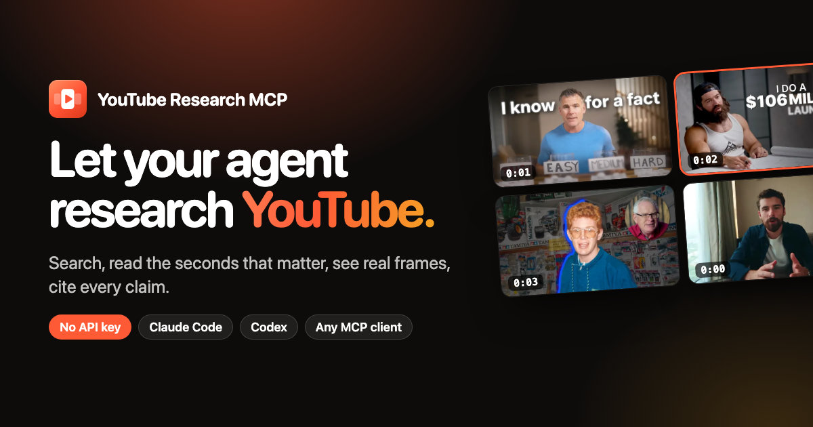

<div align="center">

<a href="https://youtube-research-mcp.vercel.app/"></a>

# YouTube Research MCP

**A keyless YouTube MCP server and research skill for AI agents.**<br>
Multi-language YouTube search with transcript highlights, transcripts by time range, chapter or query, real video frames, comments and channel outlier scores, in Claude Code, Codex and any MCP client.

[Website](https://youtube-research-mcp.vercel.app/) ·
[Install](#install) ·
[Tools](#tools) ·
[The skill](#the-research-skill) ·
[FAQ](#faq)


</div>

---

## What it does

Ask your agent things like:

> *"List 20 hooks from this year's top AI productivity videos, with hook type, what's on screen, and a link to the second."*
>
> *"Which of @channel's videos broke out this year, and what do they have in common?"*
>
> *"What do creators say is the biggest mistake with AI note-taking? Quote them."*

…and get back a table with **verbatim quotes, `?t=` timestamp links and a coverage line** (what was searched, reviewed and skipped). No YouTube Data API key, no OAuth, no cookies.

Most YouTube MCP servers expose one call per video and dump whole transcripts into context. That falls apart when an agent has to look at 50 videos. This one follows the pattern that works for web-search agents: **few tools, results that are already useful, and the research method in a skill.**

## Features

- 🔎 **Multi-query, multi-language search in one call.** Up to 12 queries, each with its own interface language and region (`hl`/`gl`), merged and de-duplicated. Videos found by several queries rank higher.
- ✨ **Transcript highlights.** The top results come with the passages that match your topic, with timestamped links, so the agent often never opens a transcript.
- ✂️ **Read only what you need.** Transcripts by time range (`start: 0, end: 30` for hooks), by chapter, or only the passages matching a query. Up to 25 videos per call.
- 🎞️ **Real video frames.** Decoded frames (up to 1280 px) evenly spaced over a range or at exact seconds. On-screen text, b-roll and screen demos become visible. ffmpeg reads only the bytes around each frame, never the whole video.
- 📈 **Outlier scores.** A channel's videos scored against its median views, to find the breakouts. Views/day on every search result.
- 💬 **Details, chapters and searchable comments.** Exact publish date, likes, comment count, tags, description, chapters (or description timestamps), thumbnails. Comments can be searched, filtered by likes or author, sorted by likes and expanded with replies; every answer says how many were scanned and matched.
- 🧾 **Nothing disappears silently.** Every response ends with a coverage footer (raw → unique → after filters, what was dropped and why), and per-video failures carry a reason code.
- 🛡️ **Careful with YouTube's limits.** API calls and caption downloads have separate queues. A caption rate limit triggers a cooldown instead of retries, and the tools say exactly how long to wait while everything else keeps working. Optional `YT_PROXY` for big sweeps.
- 🧠 **A research skill.** It plans queries in every relevant language, fans out to parallel subagents, then merges, spot-checks quotes and reports coverage.

## Install

### The easy way: ask your agent

Paste this into Claude Code, Codex, Cursor or any agent that can run commands:

```text
Install YouTube Research MCP for me from https://github.com/jindratilk/youtube-research-mcp. Follow the "Install instructions for AI agents" in its README for the client you are running in: the plugin (MCP server + research skill) in Claude Code or Codex, otherwise the MCP server config. Then run youtube_doctor and tell me whether everything works, and if I need to restart anything.
```

### Claude Code (plugin: MCP server + skill)

```bash
claude plugin marketplace add jindratilk/youtube-research-mcp
```

```bash
claude plugin install youtube-research@youtube-research
```

### Codex (plugin: MCP server + skill)

```bash
codex plugin marketplace add jindratilk/youtube-research-mcp
```

```bash
codex plugin add youtube-research@youtube-research
```

### Claude Desktop, Cursor, Windsurf, VS Code, Zed, any MCP client

```json
{
  "mcpServers": {
    "youtube": {
      "command": "npx",
      "args": ["-y", "github:jindratilk/youtube-research-mcp"]
    }
  }
}
```

The skill is optional outside the plugins: copy [`skills/youtube-research`](skills/youtube-research) into your agent's skills folder.

### From source

```bash
git clone https://github.com/jindratilk/youtube-research-mcp && cd youtube-research-mcp && npm install && npm run build
```

```bash
claude mcp add youtube -- node "$PWD/dist/index.js"
```

**Requirements:** Node.js 20+. `dist/index.js` is one bundled file with no runtime dependencies. For video frames also install **yt-dlp** and **ffmpeg** (`brew install yt-dlp ffmpeg`); yt-dlp also serves as a transcript fallback.

## Install instructions for AI agents

If a user asked you to install YouTube Research MCP, follow these steps exactly.

1. **Check Node.js:** `node --version` must be 20 or newer. If it is older or missing, stop and tell the user.
2. **Install for the client you are running in:**
   - **Claude Code** (the `claude` CLI exists): run `claude plugin marketplace add jindratilk/youtube-research-mcp`, then `claude plugin install youtube-research@youtube-research`. This installs the `youtube` MCP server and the `youtube-research` skill.
   - **Codex** (the `codex` CLI exists): run `codex plugin marketplace add jindratilk/youtube-research-mcp`, then `codex plugin add youtube-research@youtube-research`.
   - **Any other MCP client:** add this server to the client's MCP config, keeping existing entries: `"youtube": { "command": "npx", "args": ["-y", "github:jindratilk/youtube-research-mcp"] }`. Common config files: Claude Desktop `~/Library/Application Support/Claude/claude_desktop_config.json` (macOS) or `%APPDATA%\Claude\claude_desktop_config.json` (Windows); Cursor `~/.cursor/mcp.json`; Windsurf `~/.codeium/windsurf/mcp_config.json`; VS Code `.vscode/mcp.json` (uses a `servers` key instead of `mcpServers`). If the client supports skills, copy `skills/youtube-research` into its skills folder.
3. **Verify now, without a restart:** run `npx -y github:jindratilk/youtube-research-mcp --doctor`. Every line should start with ✓. `yt-dlp` and `ffmpeg` are optional (needed only for video frames); if they are missing, offer to install them (`brew install yt-dlp ffmpeg` on macOS) but do not install without asking. A `[rate_limited]` transcript line means YouTube is throttling this IP for a while; everything else still works.
4. **Tell the user** what you installed, the doctor result, and that they need to start a new session (or restart the app) for the new tools to appear.

## Tools

| Tool | What it does |
|---|---|
| [`youtube_search`](#youtube_search) | Multi-query search with filters and transcript highlights |
| [`youtube_fetch`](#youtube_fetch) | Batch read: transcript slices, real frames, details, chapters, comments, thumbnail |
| [`youtube_channel`](#youtube_channel) | A channel's videos with ×median outlier scores |
| [`youtube_doctor`](#youtube_doctor) | Checks every YouTube path from your machine, with timings |

### `youtube_search`

```json
{
  "queries": [
    "AI productivity workflow",
    "how I use AI to save 10 hours a week",
    { "query": "productividad con IA", "hl": "es", "gl": "ES" }
  ],
  "uploaded": "year",
  "minViews": 10000,
  "highlights": 5
}
```

| Parameter | Meaning |
|---|---|
| `queries` | 1–12 strings or `{query, hl, gl}` objects, run in parallel and merged |
| `limit` | Results per query before merging (default 10, max 50) |
| `uploaded` | `hour` · `today` · `week` · `month` · `year` (server-side) |
| `publishedAfter` / `publishedBefore` | `YYYY-MM[-DD]`, applied after search, approximate |
| `duration` | `short` (<4 min) · `medium` (4–20) · `long` (>20) |
| `minDurationSec` / `maxDurationSec` / `minViews` | Post-filters |
| `shorts` | `exclude` (default) · `include` · `only` |
| `captionsOnly` | Only videos with subtitles/CC |
| `sort` | `relevance` · `views` · `date` |
| `highlights` / `highlightsPerVideo` | How many top results get transcript passages (default 5) and how many each (default 3) |
| `highlightQuery` | Highlight something other than the search topic, e.g. `["biggest mistake"]` |
| `transcriptLangs` | Preferred caption languages; default is the video's original language |

### `youtube_fetch`

```json
{
  "videos": ["https://youtu.be/TL8V41Ea6oM", "htZRCE2GgIs"],
  "parts": ["details", "transcript", "frames"],
  "start": 0,
  "end": 30,
  "frames": 4
}
```

| Parameter | Meaning |
|---|---|
| `videos` | 1–25 URLs or IDs (a `?t=` in a URL is used as the start) |
| `parts` | `details` · `transcript` · `chapters` · `comments` · `thumbnail` · `frames` |
| `start` / `end` | Range for transcript and frames, in seconds or `m:ss` |
| `chapter` | Limit to the chapter whose title contains this text |
| `query` / `matches` | Return only matching transcript passages instead of the full text |
| `timestamps` | `paragraph` (~30 s blocks, default) · `segment` · `none` |
| `maxCharacters` | Transcript budget per video (default 12000); truncation says where to resume |
| `frames` / `frameAt` / `frameWidth` | N evenly spaced frames, or exact seconds; width up to 1280 px |
| `commentsLimit` | Comments to show per video (default 20, max 200) |
| `commentsQuery` / `commentsMatch` | Search inside the top comments (accent-insensitive, matches word forms); `any` (default) or `all` terms |
| `commentsMinLikes` / `commentsAuthor` | Keep only comments with enough likes, or from an author |
| `commentsScan` | How many top comments to read before filtering (default 300 when filtering, max 1000) |
| `commentsSort` | `top` (YouTube order) or `likes` (most liked first among the scanned) |
| `commentsReplies` | Also load up to N replies under each shown comment (max 20) |

### `youtube_channel`

```json
{ "channel": "@aliabdaal", "limit": 60, "minOutlier": 2 }
```

Videos, Shorts or streams; `latest` · `popular` · `oldest`; up to 300 videos; subscriber and video counts; `publishedAfter`; `minOutlier` to keep only breakouts.

### `youtube_doctor`

No parameters. Checks search, video details, transcripts, watch page, channels, yt-dlp and ffmpeg, and shows an active rate-limit pause.

## The research skill

[`skills/youtube-research`](skills/youtube-research/SKILL.md) turns a request into a supervised sweep:

1. **Define the result first:** the row schema and what qualifies (language, recency, views, long-form vs Shorts).
2. **Plan queries by angle and language:** how-to, story, tools, mistakes; the user's language plus English, written natively.
3. **Spend transcripts carefully:** pick by metadata first; transcripts are the rate-limited resource.
4. **Fan out:** up to 3 parallel Haiku subagents, each with exact video IDs, the schema, and the closing lines `videos_reviewed: N` / `skipped: …`.
5. **Merge and verify:** de-duplicate by video, spot-check quotes against the transcript, report coverage.

References: [searching](skills/youtube-research/references/searching.md) · [hooks (10-type taxonomy)](skills/youtube-research/references/hooks.md) · [quotes & claims](skills/youtube-research/references/quotes-claims.md) · [creators & outliers](skills/youtube-research/references/creators-outliers.md) · [synthesis](skills/youtube-research/references/synthesis.md).

## How it works

- **No API key:** talks to YouTube's internal Innertube API (the one the website and apps use) with plain HTTPS. Search, watch page, channels and comments use the web client; the player request uses the Android/iOS clients, whose caption URLs work without a PO token.
- **Highlights:** lexical passage scoring in memory per request. It folds accents, stems by prefix (so `productivity` matches `productive`), weights rare terms higher and rewards passages that hit several concepts.
- **Frames:** yt-dlp resolves a ≤720p stream URL; ffmpeg seeks with HTTP range requests and decodes one frame per timestamp.
- **Stateless:** no database or index. A 15-minute in-memory cache means search → fetch never downloads the same transcript twice.

## Configuration

| Env var | Default | Meaning |
|---|---|---|
| `YT_MCP_TOOLS` | all | Comma-separated tools to expose |
| `YT_MAX_CONCURRENCY` / `YT_MIN_GAP_MS` | 4 / 120 | API request queue |
| `YT_CAPTION_CONCURRENCY` / `YT_CAPTION_GAP_MS` | 2 / 350 | Caption download queue |
| `YT_CAPTION_COOLDOWN_MS` | 60000 | First pause after a caption 429 (doubles per repeat, max 15 min) |
| `YT_PROXY` | none | HTTP(S) proxy for all YouTube requests, yt-dlp and ffmpeg |
| `YT_TIMEOUT_MS` | 15000 | Per-request timeout |
| `YT_CACHE_TTL_MS` | 900000 | In-memory cache lifetime |
| `YT_FRAME_MAX_HEIGHT` / `YT_FRAME_CONCURRENCY` | 720 / 3 | Stream quality for frames; parallel ffmpeg processes |
| `YT_DLP` / `YT_DLP_PATH` / `FFMPEG_PATH` | on / `yt-dlp` / `ffmpeg` | Disable or locate the helpers |
| `YT_DEBUG` | off | Log every YouTube request (status, queue wait, latency) to stderr |
| `YT_WEB_CLIENT_VERSION`, `YT_ANDROID_CLIENT_VERSION`, `YT_IOS_CLIENT_VERSION` | built in | Override Innertube client versions if YouTube starts rejecting them |

## Honest limits

- **Transcripts are rate-limited per IP.** In testing, a burst of roughly 80–100 transcripts within a few minutes triggered HTTP 429 on captions (yt-dlp too, since it uses the same endpoint), while search and metadata kept working. Innertube's `get_transcript` endpoint is closed to anonymous clients, so there is no second keyless source. The server pauses and tells the agent when to retry; for sweeps of hundreds of videos use `YT_PROXY`.
- **Search dates are approximate** ("3 weeks ago" → ±1 unit). `youtube_fetch` returns the exact publish date.
- **No server-side date sort:** YouTube dropped it; `sort: "date"` re-sorts fetched results, so pair it with `uploaded`.
- **Comments are the top ones:** YouTube does not offer anonymous clients the "newest first" sort, and comment search covers the scanned top comments (up to 1000), not every comment on the video.
- **No captions, no transcript:** there is no speech-to-text in the server. Frames still work.
- **Frames take ~10–20 s for the first frames of a video** (stream lookup), then ~2 s each; max 20 per video and 40 per call.

## FAQ

**Does it need a YouTube API key?** No. No API key, OAuth or cookies.

**Which clients does it work with?** Any MCP client over stdio: Claude Code, Codex, Claude Desktop, Cursor, Windsurf, VS Code, Zed and more. Claude Code and Codex get the plugin with the skill.

**Does it download videos?** No. Transcripts come from caption files; frames are decoded from small byte ranges of the stream.

**Does it work for non-English content?** Yes: per-query language and region, original-language transcripts by default, and accent-aware highlights.

**Researching Instagram Reels too?** See the sibling project [Reels Research MCP](https://github.com/jindratilk/reels-research-mcp).

**Is it affiliated with YouTube or Google?** No. It is an independent open-source project. Use it in line with YouTube's terms and respect creators' rights.

## Development

```bash
npm test          # offline unit tests: parsing, highlights, filters, frame spacing
npm run smoke     # end-to-end against live YouTube through a real MCP client
npm run dev       # run from source
npm run build     # typecheck + bundle to dist/index.js
```

Layout: `src/innertube.ts` (HTTP, queues, errors) · `src/youtube.ts` (search, player, transcripts, watch page, comments, channels) · `src/highlights.ts` · `src/frames.ts` · `src/tools/*` (MCP tools) · `skills/` · `docs/` (website).

## License

[MIT](LICENSE). Not affiliated with YouTube or Google. YouTube is a trademark of Google LLC.

<sub>Keywords: YouTube MCP server, YouTube transcript MCP, YouTube search for AI agents, Model Context Protocol, Claude Code plugin, Codex plugin, YouTube without API key, YouTube hooks research, video frames for LLMs, agent skill.</sub>
